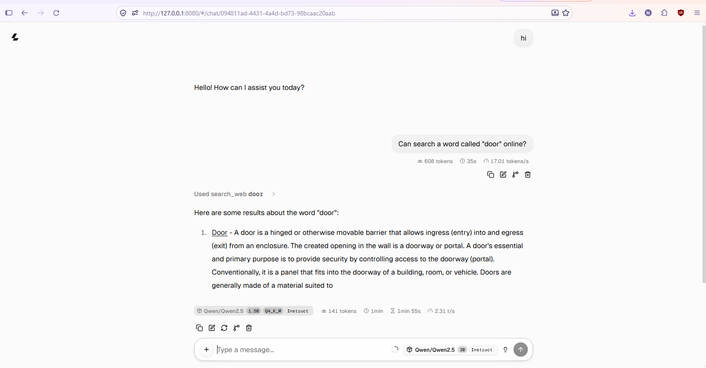

# Local LLM with Web Search (llama.cpp + MCP)

A small AI assistant that runs on your own computer (CPU only, no GPU, no paid services) and can search the web. It uses a 4-bit quantized open-source model served by [llama.cpp](https://github.com/ggml-org/llama.cpp), plus a custom tool server written in Python that gives the model live web search through DuckDuckGo.

## Demo

[](resources/example.mp4)

[🎬 Watch Demo Video](resources/example.mp4)

## Screenshot


## What it does

- Runs a **Qwen2.5 3B Instruct** model (GGUF, Q4_K_M) locally with llama.cpp.
- Gives you a ChatGPT-style chat page in the browser (built into llama.cpp).
- Adds a `search_web` tool through the **Model Context Protocol (MCP)**, so the model can decide to look things up online.
- Includes a second, simpler chat app (Flask) with a "Search the web" checkbox, as a more predictable alternative.

## How it works

```
Browser (chat page, 127.0.0.1:8080)
        |
        v
llama-server (llama.cpp) + Qwen 3B model     <-- --jinja enables tool calling
        |
        |  MCP proxy (--webui-mcp-proxy)
        v
mcp_websearch.py (FastMCP server, 127.0.0.1:8000/mcp)
        |
        v
DuckDuckGo search (ddgs library)
```

The page sends your message to llama-server. If the model decides it needs current information, it calls the `search_web` tool. llama-server forwards the call to the MCP server, which searches DuckDuckGo and returns titles, links and snippets. The model then writes its answer from those results.

The proxy is used so the browser never calls port 8000 directly, which avoids CORS (cross-origin) errors.

## Folder structure

```
.
├── README.md             this file
├── llama_commands.txt    all PowerShell commands (setup, start, troubleshooting)
├── start.bat             one-click launcher for the web search version
├── requirements.txt      Python packages
├── docs/
│   └── screenshot.png    screenshot of the working chat
└── scripts/
    ├── mcp_websearch.py      MCP tool server that provides search_web
    └── chat_search_app.py    alternative Flask chat app with a search checkbox
```

**Not included in the repo** (download separately):

- llama.cpp binaries (e.g. `llama-b12675-bin-win-cpu-x64`)
- Model files (`*.gguf`). llama.cpp downloads them automatically on first run.

## Requirements

- Windows with PowerShell (the commands are written for Windows)
- Python 3.10 or newer
- About 4 GB of free RAM for the 3B model and about 2 GB of disk space
- Internet for the first model download and for web searches

## Setup

**1. Download llama.cpp**

- Go to the [llama.cpp releases page](https://github.com/ggml-org/llama.cpp/releases).
- Under the latest release, open **Assets** and download `llama-bXXXX-bin-win-cpu-x64.zip` (XXXX is the build number).
- Unzip it, for example to `D:\llama\llama-b12675-bin-win-cpu-x64`.
- Tested with build **b12675**. Newer builds should work, but the MCP flags (`--jinja`, `--webui-mcp-proxy`) are new and may change. If a flag is rejected, check `llama-server.exe --help`.

**2. Create the model folder**

```powershell
mkdir D:\llama\models
```

**3. Install the Python packages** (from the repo folder)

```powershell
pip install -r requirements.txt
```

This installs `fastmcp`, `ddgs`, `flask` and `requests`.

**4. Edit the paths** in `start.bat` and `llama_commands.txt` if your folders differ from `D:\llama`.

## Run: web search in the main chat page

The easiest way is to double-click **`start.bat`**. It opens the search tool in its own window and starts llama-server.

Or do it manually in two PowerShell windows.

**Window 1: search tool**

```powershell
cd scripts
python mcp_websearch.py
```

**Window 2: model server**

```powershell
cd D:\llama\llama-b12675-bin-win-cpu-x64
$env:LLAMA_CACHE = "D:\llama\models"
.\llama-server.exe -hf Qwen/Qwen2.5-1.5B-Instruct-GGUF:Q4_K_M --port 8080 -c 4096 --jinja --webui-mcp-proxy
```

The first run downloads the model (about 2 GB). Wait until the log says `listening on http://127.0.0.1:8080`.

**Then, in the browser (first time only):**

1. Open <http://127.0.0.1:8080> and press Ctrl+F5.
2. Open settings (gear icon) and go to the MCP section.
3. Add a server: `http://127.0.0.1:8000/mcp`
4. Turn on the llama-server proxy option for it and connect.
5. In the chat, enable the `search_web` tool.
6. Ask: *"Use the search_web tool to find [your question]."*

> Use `127.0.0.1` everywhere, not `localhost`. The browser treats them as different sites, and chat history is stored per address.

## Run: alternative Flask app

Start llama-server as above (the `--jinja` and `--webui-mcp-proxy` flags are not needed for this one), then:

```powershell
cd scripts
python chat_search_app.py
```

Open <http://127.0.0.1:5000> and use the **Search the web** checkbox. Here the search always happens when the box is ticked, so it does not depend on the model choosing to call a tool.

## Troubleshooting

| Problem | Fix |
|---|---|
| MCP shows "NetworkError" | Make sure `mcp_websearch.py` is running, and llama-server was started with `--jinja --webui-mcp-proxy` with the proxy option turned on in settings. Opening <http://127.0.0.1:8000/mcp> should show "Missing session ID", which means the server is up. |
| Port 8000 already in use | Run `netstat -ano \| findstr :8000`, then `taskkill /PID <number> /F`. |
| 503 errors right after starting | The model is still loading. Wait a minute. |
| Spinner never stops | Check the llama-server window. If it is idle, press Ctrl+F5 to reload. |

More commands are in [`llama_commands.txt`](llama_commands.txt).

## Known limitations

- Replies take roughly 30 to 90 seconds with search on CPU.
- The 3B model decides by itself when to search and sometimes answers from memory or misreads the results. Explicit prompts such as "search online for ..." help. Larger models handle tools better.
- The MCP proxy in llama.cpp is experimental and meant for local use only. Do not expose port 8080 to other computers or networks.
- Search queries are sent to DuckDuckGo, so this mode is not fully offline.
- Search results are snippets only. The tool does not read full web pages.

## Future work

- Fetch and summarize full web pages, not only snippets
- Retrieval over local documents (RAG), e.g. course material
- A domain assistant, e.g. helping students plan technology start-up ideas
- Try low-code agent platforms (n8n, Flowise, Dify) against the same OpenAI-compatible endpoint (`http://127.0.0.1:8080/v1`)
- Try larger or newer models as hardware allows

## Acknowledgements

Built with [llama.cpp](https://github.com/ggml-org/llama.cpp), the Qwen2.5 models (Alibaba Cloud), [FastMCP](https://github.com/jlowin/fastmcp), the `ddgs` search library and Flask. AI assistance was used while building this project; the setup was tested and debugged by the author.
